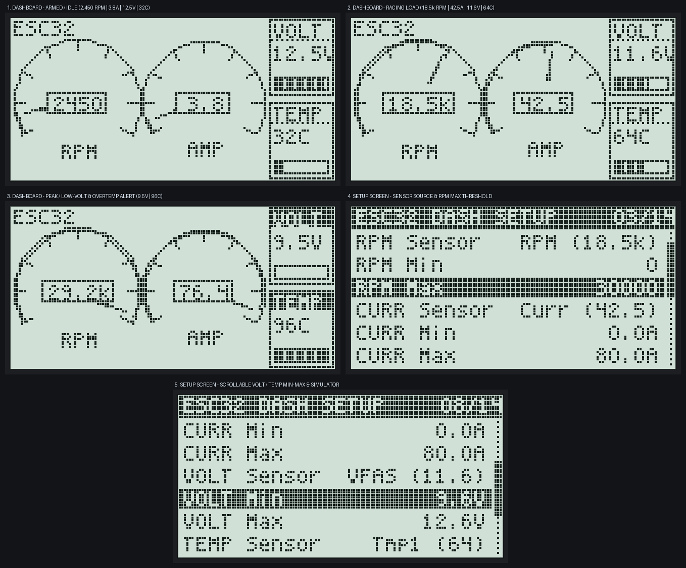
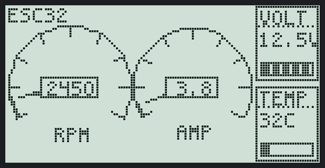
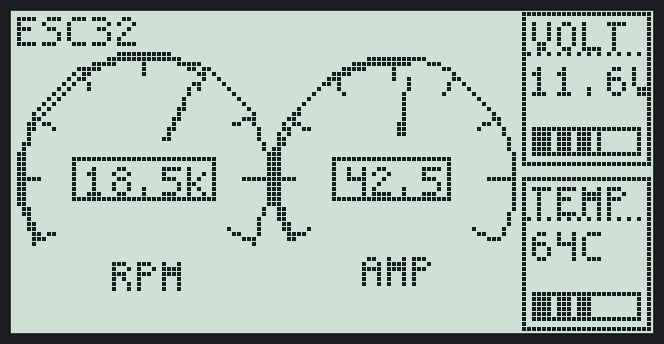
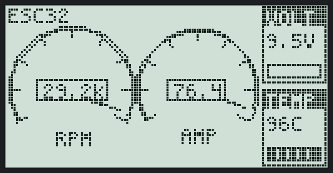
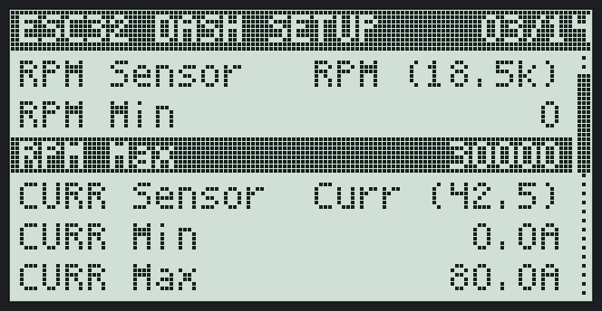
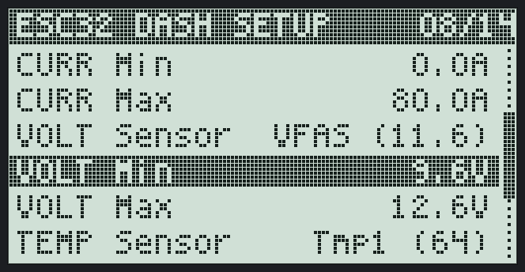

# ESCape32 Automotive Telemetry Dashboard for RadioMaster MT12

A modern, automotive-inspired telemetry dashboard Lua script for the **RadioMaster MT12** running **EdgeTX v2.11.3** (`128×64` monochrome LCD). Designed specifically for surface RC models running **ESCape32** ESC firmware over **FrSky D16v2 (S.Port / F.Port)** telemetry.



---

## Features

- **Automotive Instrument Cluster Layout (`128×64` Monochrome HMI)**
  - **Primary RPM Tachometer (Left):** `240°` swept circular dial with fixed tick scale, thickened active progress rim, moving needle, and centered high-contrast digital readout (`2450` / `18.5k`).
  - **Primary Current Ammeter (Center):** `240°` swept circular dial with live amperage needle and centered digital readout (`42.5 A`).
  - **Secondary Voltage & Temperature Cards (Right):** Segmented 5-bar horizontal gauges with live numeric readouts (`11.6V`, `64C`) and automatic reverse-video warning headers when battery voltage drops below `Min` or ESC temperature reaches `Max`.
- **On-Radio Interactive Setup Screen**
  - Map each gauge (`RPM`, `CURR`, `VOLT`, `TEMP`) to any discovered telemetry sensor on your radio while previewing live sensor values inline.
  - Customize `Min` and `Max` scale ranges and alert thresholds for any battery cell count (2S–6S+) or motor KV.
  - Settings persist automatically to `/SCRIPTS/TELEMETRY/esc32.cfg`.
- **Built-in Bench Simulator (`Test Sim`)**
  - Test all needles, segmented bars, and threshold alerts directly on the radio without powering up your RC car.

---

## Repository Structure

```text
mt12-esc32-dashboard/
├── SCRIPTS/
│   └── TELEMETRY/
│       └── esc32.lua                 # Main EdgeTX telemetry script (copy to radio SD card)
├── docs/
│   └── images/                       # LCD screenshots of dashboard states & setup screen
├── LICENSE                           # MIT License
└── README.md                         # Documentation & installation guide
```

---

## Hardware & Firmware Requirements

- **Radio:** RadioMaster MT12 (4-in-1 or ELRS with external FrSky module)
- **Radio Firmware:** EdgeTX `v2.11.3` (128×64 B&W LCD)
- **ESC:** ESCape32 with S.Port / F.Port telemetry enabled
- **Receiver Link:** FrSky D16v2 (e.g., R-XSR, Archer R4/R6, GR6/GR8) connected to the ESCape32 telemetry pad

---

## Installation

1. **Download the Script:**
   Copy `SCRIPTS/TELEMETRY/esc32.lua` from this repository onto your RadioMaster MT12 SD card into the exact same folder:
   ```text
   /SCRIPTS/TELEMETRY/esc32.lua
   ```
   *(Keep the filename 8 characters or fewer so EdgeTX displays it in the telemetry screen selector.)*

2. **Discover ESCape32 Telemetry Sensors:**
   - Power on your MT12 and your RC model so the FrSky D16v2 receiver and ESCape32 ESC are active.
   - On the MT12, open **Model Settings (`MDL`) → Telemetry**.
   - Scroll down and select **Discover new sensors**.
   - Confirm that `RPM`, `Curr`, `VFAS`, and `Tmp1` (or `Tmp2`) appear in the sensor list, then select **Stop discovery**.

3. **Assign the Telemetry Screen:**
   - Open **Model Settings (`MDL`) → Display (Telemetry Screens)**.
   - Set **Screen 1** to **Script** and choose **`esc32`**.
   - Return to the main screen and press the **TELE** button to launch the dashboard.

---

## Controls & Setup Guide

### Dashboard View
| Action | Control on RadioMaster MT12 |
| :--- | :--- |
| **Open Setup Screen** | Long-press **ENTER** *(or scroll wheel 1 click to highlight **`SET`** at top-left, then press **ENTER**)* |
| **Dismiss Focus** | Press **RTN / EXIT** |

### Setup Screen (`ESC32 DASH SETUP`)
| Row | Parameter | Default (3S LiPo) | Description |
| :--- | :--- | :--- | :--- |
| `01–03` | `RPM Sensor / Min / Max` | `RPM` / `0` / `30000` | Tachometer source and needle scale range |
| `04–06` | `CURR Sensor / Min / Max` | `Curr` / `0.0A` / `80.0A` | Current draw source and ammeter scale range |
| `07–09` | `VOLT Sensor / Min / Max` | `VFAS` / `9.6V` / `12.6V` | Pack voltage source; triggers inverted **`VOLT`** alert at `<= Min` |
| `10–12` | `TEMP Sensor / Min / Max` | `Tmp1` / `20C` / `95C` | ESC temperature source; triggers inverted **`TEMP`** alert at `>= Max` |
| `13` | `Test Sim` | `OFF` | Sweeps simulated ESCape32 telemetry across all dials for bench testing |
| `14` | `Save & Exit` | `[OK]` | Saves configuration to `/SCRIPTS/TELEMETRY/esc32.cfg` and returns to dashboard |

- **Editing Values:** Scroll the wheel to highlight a row, press **ENTER** to enter blinking edit mode, scroll to adjust, and press **ENTER** (or **RTN**) to confirm and save.

---

## Gallery

| Armed / Idle | Racing Load | Peak & Threshold Alert |
| :---: | :---: | :---: |
|  |  |  |

| Setup: Sensor & Max Limit | Setup: Scrollable Min/Max |
| :---: | :---: |
|  |  |

---

## Credits & License

- **Author:** [@guerradr](https://github.com/guerradr) (developed with AI code assistance)
- **License:** Released under the [MIT License](LICENSE).
